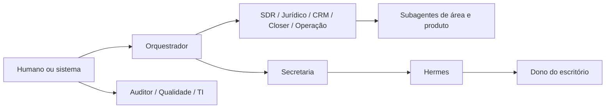

# Governança Agentica Core

**Status:** implementada e validada localmente  
**Contrato:** `agent-governance-v1.4.0`  
**Escopo:** runtime nativo do Meu Executivo, sem efeitos externos habilitados  
**Fonte de verdade:** `app/services/agent_governance_service.py`

## Objetivo

Garantir que agentes e subagentes cooperem sem ampliar a própria autoridade, misturar clientes ou contas, contornar correções humanas, trocar de área jurídica, usar ferramentas não concedidas ou produzir efeitos externos sem uma decisão humana explícita.

O modelo de IA não define governança. A política é determinística, versionada e avaliada antes de RAG, memória, documentos, conversa ou chamada de modelo.

## Cadeia de autoridade

Regras rígidas:

1. O Orquestrador coordena trabalho; Hermes nunca orquestra.
2. Uma delegação entre agentes só pode seguir para o filho direto declarado.
3. A profundidade informada deve corresponder exatamente ao caminho hierárquico.
4. Somente a Secretaria pode delegar ao Hermes.
5. A Secretaria só aciona Hermes quando existe solicitação real de decisão humana.
6. Somente Hermes cria a ponte com o dono do escritório.
7. Chamadas diretas ao Hermes, inclusive por endpoint operacional, são negadas; o pedido deve passar pela Secretaria.
8. Auditor, Qualidade e TI são controles independentes e só podem ser iniciados por humano ou sistema.
9. Autodelegação, ciclos, pais inexistentes e saltos hierárquicos são negados.

O Playbook Studio não redefine essa árvore. Para agentes canônicos, pai, profundidade, independência e delegados diretos são derivados da política e exibidos como contrato somente leitura. Um playbook adulterado, ainda que válido como JSON, é recusado antes de chegar ao runtime.

Agentes personalizados também não podem criar uma segunda raiz de autoridade. Todo agente customizado precisa declarar um pai já registrado no mesmo playbook; cada handoff precisa apontar para um agente existente cujo pai declarado seja exatamente o agente remetente. Alvos ausentes, raízes paralelas, atalhos entre ramos e relações pai-filho divergentes falham no schema antes da publicação.

## Escopos obrigatórios

Toda execução exige correspondência exata de:

- `workspace_id`: impede acesso entre contas SaaS.
- `client_id`: impede contexto de um cliente em outro.
- `area_key`: impede atuação fora da área jurídica autorizada.
- `product_key`: impede um subagente de usar dados de outro produto da mesma área.
- `matter_id` e `thread_id`: vinculam caso, card, documentos e conversa à mesma execução auditada.
- revisão manual do contexto: alterações do atendente prevalecem sobre inferências anteriores da IA.

Área congelada não executa agentes especializados. Orquestrador e controles independentes permanecem seguros para diagnóstico; Secretaria e Hermes só podem concluir a ponte humana de uma exceção já iniciada. O desbloqueio pertence ao Super Admin ou funcionário SaaS expressamente autorizado.

## Ordem de avaliação

1. Confirmar agente registrado e estado operacional.
2. Validar conta, caso e cliente exatos.
3. Validar iniciador, delegante e profundidade.
4. Bloquear ação sujeita a gate humano.
5. Aplicar menor privilégio às ferramentas solicitadas.
6. Validar cadeia pai-filho e a rota Secretaria → Hermes.
7. Validar área ativa, área do agente e produto do subagente.
8. Registrar decisão de governança.
9. Somente então montar contexto, consultar RAG e chamar modelo.
10. Revalidar a revisão manual antes de persistir resultado ou criar intenção externa.

Uma falha em qualquer etapa encerra a execução, registra `agent_governance_denied` e não chama modelo nem ferramenta.

## Gates humanos imutáveis

Agentes não podem executar autonomamente:

- envio externo;
- assinatura de contrato;
- alteração de honorários ou desconto;
- protocolo de petição;
- acordo ou encerramento material do caso;
- exclusão de evidência;
- desbloqueio de área;
- alteração de permissões.

No estágio local, `externalActionsAllowed` permanece `false` para toda a política.

## Menor privilégio

Cada agente recebe apenas as ferramentas declaradas no registro. A solicitação de uma ferramenta fora dessa lista falha com `TOOL_SCOPE_DENIED`. O resultado do modelo não consegue adicionar ferramentas, delegados, áreas, produtos ou permissões.

## Integridade e antirregressão

O snapshot público da política contém:

- versão semântica do contrato;
- mapa completo de pais;
- profundidade máxima;
- gates humanos;
- agentes de controle independente;
- regras de isolamento e delegação;
- `policyDigestAlgorithm: sha256`;
- `policyDigest`, calculado sobre a representação canônica da política.

O digest permite comparar backend, auditoria e interface. Cada execução persiste a versão, o algoritmo e o SHA-256 exato da política que a autorizou. Alteração de regra exige nova versão, novo digest, testes e revisão humana. Blueprints recusam versões antigas, profundidade diferente de quatro, ponte humana diferente de Hermes ou delegador diferente de Secretaria.

O baseline de sistema usa migração versionada e restrita aos registros oficiais conhecidos. As versões históricas `v1` e `v2` permanecem imutáveis e superseded; a versão canônica `v3` foi publicada com a hierarquia atual. A migração reconhece o marcador interno do baseline antes de validar o payload legado, cria uma nova versão e nunca normaliza silenciosamente playbooks escritos pelo tenant. Conteúdo customizado inválido continua falhando de forma fechada.

Um pedido de handoff oriundo da experiência nativa de conversa também não confia no payload da interface. Ele exige uma execução persistida do Hermes em estado `waiting_human`, ligada à mesma conta, cliente, caso e conversa, com o caminho exato `orquestrador → secretaria → hermes` e com versão e digest atuais. Só depois registra a intenção de aprovação; nenhum envio externo acontece localmente.

## Códigos de negação principais

| Código | Proteção |
|---|---|
| `CROSS_WORKSPACE_ACCESS_DENIED` | separação entre contas SaaS |
| `CROSS_CLIENT_ACCESS_DENIED` | separação entre clientes |
| `AGENT_SCOPE_MISMATCH` | separação entre áreas |
| `AGENT_PRODUCT_SCOPE_MISMATCH` | separação entre produtos |
| `INVALID_DELEGATION_PATH` | cadeia pai-filho |
| `DELEGATION_DEPTH_INCONSISTENT` | profundidade exata |
| `OWNER_BRIDGE_DELEGATOR_REQUIRED` | somente Secretaria aciona Hermes |
| `OWNER_BRIDGE_CANNOT_ORCHESTRATE` | Hermes não coordena agentes |
| `INDEPENDENT_CONTROL_REQUIRED` | independência de Auditor, Qualidade e TI |
| `HUMAN_GATE_REQUIRED` | decisão irreversível reservada ao humano |
| `TOOL_SCOPE_DENIED` | menor privilégio |
| `AREA_FROZEN` | produto jurídico não contratado ou não liberado |

## Responsabilidades

- **Orquestrador:** classifica, escolhe área/produto, distribui e acompanha; não substitui especialistas.
- **Especialista:** atua somente na área e produto vinculados, com ferramentas concedidas.
- **CRM:** registra dados confirmados e respeita toda alteração manual mais recente.
- **Secretaria:** coordena agenda e exceções; é a única porta agentica para Hermes.
- **Hermes:** comunica o dono, recebe decisão e devolve a decisão ao fluxo; não delega trabalho.
- **Auditor:** detecta ausência de resposta, falha de envio, divergência visual/real e resposta inadequada; registra evidência e aciona reparo autorizado.
- **Qualidade:** avalia aderência a playbooks e desempenho sem alterar operação silenciosamente.
- **TI:** trata falha técnica com acesso concedido, trilha e aprovação.
- **Humano:** mantém veto, corrige contexto e decide ações de alto impacto.

Comunicação interna, tarefas e referências a cards pertencem ao Orquestrador. Hermes pode apresentar ao dono um resumo autorizado desse trabalho, mas não assume a propriedade das filas nem coordena a equipe.

## Evidências locais

As provas automatizadas cobrem hierarquia acíclica, isolamento, cadeia direta, profundidade exata, rota Secretaria → Hermes, gates humanos, ferramentas, áreas congeladas, proteção contra adulteração de blueprint, revisão manual e registro de negações.

Também são exercitados: recusa de handoff sem `AgentRun` persistido, recusa de digest desatualizado ou adulterado, vínculo exato entre run/caso/conversa, normalização da hierarquia no playbook padrão e bloqueio de atalhos configurados no Playbook Studio.

Execução local de 22/07/2026:

- `351 passed`: governança, serviço e API de agentes, Playbooks e ponte nativa de atendimento humano.
- `42 passed`: recorte de hierarquia, migração do baseline, API de Playbooks e compatibilidade do schema local.
- `25 passed`: contratos de frontend, catálogo de agentes e experiência do Playbook Studio.
- `tsc --noEmit`: aprovado.
- build Vite de produção e verificação de bundle same-origin: aprovados.
- `ruff check`: aprovado nos módulos e testes alterados.
- SPA local: biblioteca e editor do baseline `v3` carregados sem erro de console; nenhuma ação externa habilitada.

Arquivos principais:

- `app/services/agent_governance_service.py`
- `app/services/klm_agent_service.py`
- `app/services/oss_native_chattermate_service.py`
- `app/services/rocketchat_bridge_service.py`
- `app/schemas/playbook.py`
- `app/services/playbook_defaults.py`
- `app/data/legal_area_catalog.py`
- `app/schemas/klm_operations.py`
- `tests/services/test_agent_governance_service.py`
- `tests/api/test_klm_agents.py`
- `tests/api/test_area_activation.py`
- `frontend/src/klm/pages/AgentsPage.tsx`
- `frontend/src/klm/pages/AreasPage.tsx`

## Limites atuais

Esta comprovação é local. Ela não declara segurança de produção, disponibilidade de provider, aprovação Meta, implantação AWS ou eficácia de integrações externas. Antes de produção ainda são obrigatórios testes com credenciais de sandbox, segregação real no PostgreSQL/RLS, observabilidade, recuperação de desastre, testes adversariais e aprovação humana do release.
# Aditivo de governança v1.5.0 — 23/07/2026

Este aditivo prevalece sobre os trechos históricos abaixo quando houver
referência à ponte humana da conversa. O **Orquestrador** é o único agente que
encaminha uma conversa operacional para a fila do atendente humano. A fila é
registrada no mesmo workspace, com usuário atribuído, evento realtime,
auditoria e notificação local, respeitando as permissões do usuário.

O **Hermes** não participa do fluxo de atendimento do cliente, não assume
conversa e não substitui o atendente. Ele é a ponte executiva do dono do
escritório: recebe avisos, resumos, métricas e pedidos autorizados. Quando a
operação exige ciência do dono, Hermes recebe somente a notificação executiva;
isso não altera a fila da conversa nem cria uma segunda rota de atendimento.

Em produção, a ponte externa do Hermes continua bloqueada até credencial,
aprovação e gate específicos. No modo local, a notificação e o evento ficam
persistidos e `externalActionsExecuted=0`.
