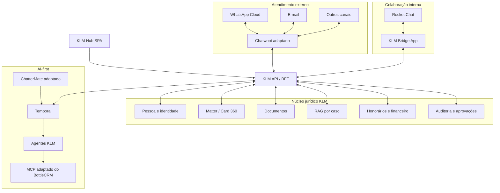

# KLM Hub - Plano Adaptation-First V2

> **Status:** `SUPERSEDED_NON_EXECUTABLE`. A meta vigente esta em
> [`KLM_HUB_META_E_PLANO_SAAS_LOCAL_V5_2026-07-19.md`](./KLM_HUB_META_E_PLANO_SAAS_LOCAL_V5_2026-07-19.md).
> Este V2 permanece como historico de arquitetura, licencas e decisoes.

**Status:** substituído, para incorporação visível na SPA, pelo [Plano de Incorporação OSS V3](KLM_HUB_PLANO_INCORPORACAO_OSS_V3.md)  
**Data:** 17 de julho de 2026  
**Escopo:** fontes auditadas, sidecars locais, adapters KLM, SPA, backend, agentes API-first e hardening  
**Gate atual:** APIs reais, canais externos e AWS permanecem bloqueados até aprovação do proprietário

## 1. Decisão executiva

O KLM Hub adotará uma estratégia **adaptation-first**. Produtos open source maduros serão usados como fundações reais, preservando suas funcionalidades e testes. Código próprio será concentrado no domínio jurídico, na experiência KLM e na orquestração AI-first.

Papéis definidos:

1. **Chatwoot:** núcleo de atendimento externo e transporte omnichannel.
2. **Rocket.Chat:** núcleo de colaboração interna estilo Slack.
3. **ChatterMate:** base de IA, handoff, knowledge, preview e editor visual de flows.
4. **BottleCRM:** base de MCP, RLS, auditoria, deduplicação e padrões de CRM.
5. **Temporal:** execução durável dos flows adaptados.
6. **KLM Hub:** SPA, domínio jurídico, Card 360, RAG por caso, políticas, agentes e relatórios.

Não serão recriados do zero recursos maduros que os upstreams já resolvem adequadamente.

## 2. Regra nova: preservar e perguntar

### 2.1 Preservação

- nenhum recurso será apagado do código baixado;
- nenhum arquivo upstream será reescrito silenciosamente;
- recursos fora do primeiro rollout permanecem disponíveis no upstream;
- “não ativar agora” não significa remover;
- configurações e telas só poderão ser ocultadas por papel ou feature flag após aprovação;
- toda adaptação será feita preferencialmente por API, plugin, bridge, overlay ou patch pequeno;
- qualquer código importado manterá licença, aviso, origem e commit.

### 2.2 Aprovação antes da implementação

Antes de cada bloco, o proprietário receberá nesta conversa:

1. lista das funcionalidades upstream encontradas;
2. recomendação do que ativar imediatamente;
3. funcionalidades que podem ficar disponíveis para fase posterior;
4. custo, dependências e riscos;
5. alterações necessárias no KLM;
6. pergunta explícita de aprovação.

Estados do catálogo:

| Estado | Significado |
|---|---|
| `preserved` | existe no upstream e não será removido |
| `proposed_now` | recomendado para a próxima implementação |
| `proposed_later` | preservado, mas recomendado para fase posterior |
| `blocked_license` | preservado na fonte, mas depende de licença/assinatura |
| `blocked_dependency` | preservado, mas depende de API, versão ou infraestrutura |
| `approved` | implementação aprovada pelo proprietário |
| `implemented` | integrado e testado no KLM |

Somente `approved` pode avançar para código do produto.

## 3. Upstreams baixados e fixados

As fontes foram baixadas em `.vendor/upstreams/`, ignoradas pelo Git para evitar repositórios aninhados. O lock versionado está em `docs/oss-upstreams.lock.json`. O download é reproduzível por `scripts/fetch_klm_upstreams.sh`.

| Projeto | Ref | Commit efetivo | Licença observada | Uso planejado |
|---|---|---|---|---|
| Chatwoot | `v4.15.1` | `97bb8ecd326299c46eacea74863976427c96fe94` | MIT fora de `enterprise/` | sidecar completo + bridge KLM |
| ChatterMate | `v1.0.14` | `9770df5b4d4909084a3b3a00ff2404d25724de90` | Apache 2.0 | sidecar completo + padrões de automação |
| BottleCRM | `0.46` | `3ab79d75ece005a414d9d3ef729b7240545d1b41` | MIT | sidecar completo + sync CRM/MCP/RLS/audit |
| Rocket.Chat | `8.6.1` | `bfd782302d20cbd672c785ac8c0d072d7cc6b0db` | MIT fora de diretórios enterprise | fonte de referência; runtime local compatível `6.13.1` + bridge |
| EmbeddedChat | `v0.2.3` | `06a0299680394b4b03f932e300bc52e52df83f80` | pacotes declaram ISC; raiz sem LICENSE | spike de compatibilidade/licença |

Os checkouts continuam imutáveis e sem arquivos copiados para o core. Os quatro produtos foram executados como sidecars locais com gateways e sessões de uso único. Chatwoot, Rocket.Chat e BottleCRM possuem bridges reconciliáveis; ChatterMate preserva o produto completo e fornece os padrões auditados de flow, handoff, preview e knowledge. Nenhum repositório upstream foi amputado ou reescrito.

O Rocket.Chat é a exceção de runtime explicitamente registrada: a fonte auditada
permanece `8.6.1`, mas o ambiente local usa `6.13.1` porque o artefato atual
air-gapped ficou somente leitura sem licença e o build FOSS exigiu dependência
privada. Isso não é liberado para produção sem novo gate técnico/licenciamento.

## 4. Rocket.Chat para o Slack interno

Sim, Rocket.Chat é adequado para o Slack interno.

Capacidades preservadas:

- canais públicos e privados;
- mensagens diretas;
- threads;
- menções;
- reações;
- arquivos;
- busca;
- pins e favoritos;
- histórico de edições;
- roles e permissões;
- slash commands;
- REST API;
- webhooks;
- Apps-Engine;
- notificações;
- clientes web e mobile;
- integrações, importação e demais recursos comunitários.

Uso jurídico proposto:

- sala privada por caso;
- canais por time e área;
- thread SDR -> Jurídico;
- agentes como bots mencionáveis;
- Orquestrador como coordenador da escalada; Secretaria consolida a exceção e Hermes atua somente como ponte com o dono;
- decisão interna ligada ao Card 360;
- canal de TI e incidentes;
- canal de marketing/track;
- busca global das discussões autorizadas.

O Rocket.Chat será a fonte da experiência colaborativa. O KLM guardará a projeção auditável, o vínculo com o caso e as decisões estruturadas.

## 5. Arquitetura-alvo

## 6. Dono de cada dado

| Dado | Fonte canônica | Projeção |
|---|---|---|
| mensagem externa e transporte | Chatwoot | timeline/RAG controlado no KLM |
| inbox, número, mailbox e template | Chatwoot | IDs e métricas no KLM |
| pessoa e identidade unificada | KLM | `external_id` no Chatwoot |
| caso, subtema, documentos e honorários | KLM | referências mínimas nos upstreams |
| sala, thread e reação interna | Rocket.Chat | projeção auditável no KLM |
| decisão interna estruturada | KLM | referência à mensagem Rocket.Chat |
| definição e versão do flow | KLM/ChatterMate adaptado | bundle no Temporal |
| execução durável | Temporal | trace e resumo no KLM |
| agente e capabilities | KLM | identidade bot nos canais |
| RAG e proveniência | KLM | sem réplica integral nos chats |
| credenciais | secret store | referência opaca |

## 7. SPA única

A shell React do KLM continua responsável por navegação, autenticação, marca, permissões, tema, telemetria e roteamento.

### 7.1 Conversas externas

Chatwoot será usado como backend e como base real da interface.

Estratégia preservada para a etapa de integração autenticada:

- criar uma entrada KLM no dashboard Chatwoot;
- montar inbox, timeline, composer, anexos, templates, notas e atribuição como microfrontend;
- manter todas as funcionalidades originais preservadas;
- a shell decide quais rotas e comandos cada papel pode visualizar;
- adicionar painel jurídico KLM, autoria de agente e controles IA/flow/humano;
- carregar sob demanda e isolar falhas.

Fallback preservado:

- usar o Chatwoot completo em rota same-origin com SSO;
- ou usar o backend Chatwoot em modo headless com a UI KLM.

A escolha entre os três formatos será apresentada após um spike, antes da implementação definitiva.

### 7.2 Colaboração interna

Rota proposta: `/app/interno`.

- Rocket.Chat completo sob SSO;
- sala compacta do caso em Conversas/Card 360;
- workspace completo para canais, DMs, busca e threads;
- EmbeddedChat testado em microfrontend isolado;
- nenhuma atualização global do React sem aprovação e testes.

O EmbeddedChat fixado pede React 19 e o KLM usa React 18.3. O spike avaliará bundle isolado, cliente Rocket.Chat completo e componentes MIT do Fuselage. Nenhuma opção será implementada definitivamente sem decisão do proprietário.

### 7.3 Flows

Rota proposta: `/app/flows`.

- editor e preview do ChatterMate preservados;
- integração via microfrontend Vue ou adaptação de componentes;
- catálogo completo de nós upstream mantido;
- novos nós jurídicos adicionados sem apagar os existentes;
- publicação em DSL tipado;
- execução no KLM/Temporal;
- visualização real-time do grafo.

### 7.4 CRM e Caso 360

- interface jurídica KLM permanece;
- BottleCRM fornece padrões, MCP e código compatível;
- frontend Svelte permanece baixado e preservado;
- seu uso como microfrontend ou apenas referência será decidido após catálogo funcional e spike.

## 8. Chatwoot adaptado

Capacidades a preservar e catalogar:

- WhatsApp Cloud;
- múltiplos inboxes e números;
- embedded signup;
- templates;
- anexos e mídia;
- e-mail;
- contatos e conversas;
- inbox de API;
- notas privadas;
- labels;
- status;
- atribuição e times;
- horários de atendimento;
- automações;
- campanhas;
- webhooks;
- APIs públicas e privadas;
- relatórios;
- CSAT;
- help center;
- integrações comunitárias;
- recursos adicionais presentes na versão fixada.

Adaptações KLM propostas:

- `klm_person_id` e `klm_matter_id`;
- área, subtema e objeto do caso;
- autoria explícita do agente;
- IA/copiloto/humano;
- painel Card 360;
- documentos, RAG e honorários;
- ações comerciais;
- ligação com sala Rocket.Chat;
- policy gate antes de envio por IA;
- auditoria e KPIs jurídicos.

### 8.1 Múltiplos números

Cada número corresponde a um inbox Chatwoot, com:

- WABA e `phone_number_id`;
- status e qualidade;
- templates;
- área, time e horário;
- campanha/origem;
- IA e flows permitidos;
- kill switch;
- métricas próprias.

Regra: responder pelo inbox de origem, salvo migração explícita e auditada.

### 8.2 E-mail e RAG

1. Chatwoot recebe e organiza o e-mail;
2. webhook informa o KLM;
3. KLM resolve identidade/caso;
4. ambiguidade vai para revisão;
5. anexos viram documentos;
6. OCR/extraction cria chunks com proveniência;
7. Card 360 e flow são atualizados;
8. timeline mantém o canal original.

FreeScout não é necessário para esta arquitetura, mas nenhuma fonte baixada anteriormente será apagada sem solicitação.

### 8.3 Migração

- backend atual permanece durante shadow;
- Chatwoot processa tráfego sintético;
- reconciler compara mensagens/status;
- apenas um sender ativo por número;
- cutover por conexão;
- rollback por conexão;
- nunca dual-write real.

## 9. Rocket.Chat adaptado

### 9.1 Estrutura proposta

Canais globais:

- Comercial;
- Jurídico Saúde;
- Secretaria;
- Paralegal;
- Petições;
- Financeiro;
- Marketing;
- Track;
- TI;
- Incidentes.

Salas por caso:

- privadas;
- membros derivados do RBAC KLM;
- link para Card 360;
- tópico com subtema, urgência e estágio;
- threads por consulta, documento, reunião, proposta ou petição.

### 9.2 Agentes

- `@sdr`;
- `@juridico-saude`;
- `@crm`;
- `@closer`;
- `@secretaria`;
- `@paralegal`;
- `@peticao`;
- `@andamento`;
- `@financeiro`;
- `@cobranca`;
- `@marketing`;
- `@track`;
- `@ti`;
- `@hermes`.

Cada bot terá identidade, avatar, role, capabilities e versão. Bots não poderão se passar por humanos.

### 9.3 KLM Bridge App

Private app proposta para:

- provisionar salas e membros;
- ouvir mensagens e alterações;
- enviar eventos assinados ao KLM;
- transformar menções em tarefas de agente;
- postar respostas;
- exibir botões de aprovar/rejeitar/abrir caso/promover ao RAG;
- correlacionar sala, thread, matter, agent run e flow run;
- respeitar workspace e permissões.

Escritas críticas usarão REST API. A documentação do Rocket.Chat marca method calls da Realtime API como deprecated.

### 9.4 Registro e RAG

- toda discussão permitida fica visível e referenciada;
- edição/exclusão gera evento/tombstone no KLM;
- decisão importante é promovida ao Card 360;
- RAG não absorve automaticamente todo ruído interno;
- promoção pode ser humana, por pin ou por classificador com gate.

## 10. ChatterMate adaptado

Capacidades preservadas:

- workflow, nodes e connections;
- publicação/versionamento;
- execução e mensagens intermediárias;
- inputs, forms e conditions;
- handoff;
- transfer agent;
- structured output;
- provedores/modelos;
- knowledge search;
- pgvector;
- leitores de PDF/site;
- URL safety;
- editor e preview;
- testes;
- integrações e funções adicionais do upstream.

Adaptação de domínio:

| Upstream | KLM |
|---|---|
| `org_id` | `workspace_id` |
| `session_id` | conversa + caso |
| agente genérico | agente KLM versionado |
| knowledge global | RAG isolado por caso |
| transfer genérico | handoff Chatwoot/Rocket.Chat |
| executor comum | Temporal durável |
| API key em chamada | secret reference/model gateway |

Foi encontrado logging de `api_key` no serviço de workflow do upstream. A fonte ficará preservada, mas esse comportamento não poderá entrar no runtime KLM. A correção proposta será apresentada antes da importação.

Integrações como Shopify e Jira permanecem preservadas. A ativação ou não no KLM será perguntada no catálogo, não decidida por remoção.

### 10.1 Flow tipado

O catálogo upstream permanece. O KLM adicionará nós jurídicos tipados. Não haverá JavaScript arbitrário, SQL livre ou HTTP sem schema.

Lifecycle proposto:

- deployment: `draft`, `active`, `paused`, `disabled`, `archived`;
- run: `queued`, `running`, `sleeping`, `waiting_event`, `waiting_human`, `pausing`, `paused`, `cancelling`, `cancelled`, `completed`, `failed_retryable`, `failed_terminal`, `dead_letter`.

Desativar, pausar e cancelar são operações diferentes.

Modos:

- `deterministic`;
- `ai_copilot`;
- `ai_gated`;
- `ai_autonomous`;
- `human_only`.

Resource locks impedem envios conflitantes entre flows simultâneos.

## 11. BottleCRM adaptado

### 11.1 MCP

Estrutura reutilizada:

- search;
- get;
- create;
- update;
- delete com confirmação;
- action com allowlist;
- describe via OpenAPI;
- paginação limitada;
- autenticação por usuário;
- testes com fake client.

Entidades propostas:

- clients;
- matters;
- conversations;
- documents;
- meetings;
- proposals;
- contracts;
- powers of attorney;
- payments;
- follow-ups;
- flow runs;
- agent runs;
- approvals;
- internal decisions.

Ações externas/destrutivas exigem confirmação e audit event.

### 11.2 RLS, audit e CRM

Capacidades a preservar e avaliar:

- PostgreSQL RLS;
- cross-org/workspace detection;
- security audit log;
- API token audit;
- suspicious activity;
- custom fields;
- duplicate detection;
- business hours;
- SLA pause;
- internal notes;
- importação;
- kanban;
- casos, contatos, oportunidades, tarefas e invoices;
- frontend Svelte;
- mobile;
- integrações e módulos adicionais.

A proposta inicial é portar para FastAPI/Alembic o MCP, RLS e audit. A decisão sobre executar também o Django/Svelte completo será perguntada antes de implementação.

## 12. AI-first

Toda execução de agente registra:

- agente e versão;
- modelo;
- prompt version;
- tools/capabilities;
- contexto e fontes;
- input/output estruturados;
- confiança;
- custo/latência;
- ação resultante;
- aprovação/override;
- trace, flow, case e conversation IDs.

Fluxo de exemplo:

1. cliente envia negativa via WhatsApp;
2. Chatwoot recebe;
3. KLM resolve caso/documentos;
4. SDR é acionado;
5. SDR consulta Jurídico no Rocket.Chat;
6. Jurídico responde com evidências;
7. CRM Agent atualiza o Card;
8. Closer prepara proposta;
9. Secretaria cuida da reunião;
10. Hermes acompanha e escala humano quando autorizado.

O RAG será híbrido, isolado por workspace/caso, com proveniência e proteção contra prompt injection. ChatterMate fornecerá código e testes de knowledge; KLM manterá ownership dos chunks.

## 13. Contratos de integração

Todo evento terá:

- `event_id`;
- `event_type`;
- `schema_version`;
- `workspace_id`;
- `correlation_id`;
- `causation_id`;
- `occurred_at`;
- `producer`;
- `external_id`;
- payload validado.

Confiabilidade:

- transactional outbox;
- consumer inbox;
- idempotency keys;
- retries com backoff;
- dead-letter;
- replay autorizado;
- reconciliação;
- circuit breaker;
- kill switches;
- nenhum retry repete efeito.

MCP será usado para tools de agentes. APIs/webhooks permanecem responsáveis pelo transporte e eventos de alta frequência.

## 14. Infraestrutura local

Perfis:

| Profile | Serviços |
|---|---|
| `core` | KLM SPA, FastAPI, SQLite de aprovação, storage local e runtime de agentes/flows |
| `channels` | Chatwoot web/worker, banco e Redis próprios |
| `collaboration` | Rocket.Chat, MongoDB, bootstrap, bridge e gateway local |
| `automation` | ChatterMate API/worker/frontend, PostgreSQL e Redis próprios |
| `crm` | BottleCRM API/worker/beat/frontend, PostgreSQL e Redis próprios |

Bancos e migrations não são compartilhados entre produtos. As APIs locais dos
sidecars estão ativas; APIs de modelos, canais, provedores externos e AWS seguem
desligados.

## 15. Ordem de execução

A ordem vigente permanece: **frontend, backend, agentes, testes e somente depois APIs/AWS**.

Estado consolidado desta execução:

| Fase | Estado local | Limite preservado |
|---|---|---|
| Catálogo, pins e licenças | concluído | diretórios enterprise continuam excluídos |
| SPA e convergência UX | concluído | sem SSO externo |
| Chatwoot | sidecar, sessão e bridge reconciliável concluídos | transporte externo desligado |
| Rocket.Chat | sidecar compatível, dez canais, salas por caso e webhook bidirecional concluídos | versão atual/licença e SSO de produção bloqueados |
| BottleCRM | sidecar, sessão, sync idempotente, MCP, RLS e audit concluídos | integrações externas desligadas |
| ChatterMate | sidecar, sessão, flow, handoff, preview, knowledge e editor disponíveis | nós LLM e canais externos desligados |
| Runtime durável | FlowRevision/FlowRun, locks e lifecycle locais concluídos | Temporal não foi ativado nesta fase |
| Agentes | gateway API-first e simulador de teste concluídos | nenhuma chave ou chamada real |
| Integração e hardening | concluídos no escopo local | APIs e AWS formam a fase seguinte |

A estimativa original abaixo fica preservada como histórico de planejamento. O pacote local foi executado de forma incremental; prazo de produção só será recalculado após escolha dos providers, contas e infraestrutura.

### Fase 0 - Catálogo e aprovação (1 a 2 semanas)

- inventário funcional completo por produto;
- matriz `preserved/proposed/blocked`;
- demos locais das funções principais;
- licenças e SBOM;
- proposta de integração por bloco;
- perguntas de aprovação nesta conversa.

Nenhuma feature é implementada nessa fase.

### Fase 1 - Frontend adaptado com mocks (3 semanas)

Somente após aprovação:

- spikes Chatwoot, Rocket.Chat, ChatterMate e BottleCRM;
- shell e microfrontends;
- fixtures locais;
- desktop/mobile;
- error boundaries;
- tema KLM;
- navegação única.

### Fase 2 - Convergência UX (2 semanas)

- autoria;
- painel jurídico;
- notas e interno;
- IA/flow/humano;
- loading/offline/error;
- acessibilidade;
- regressão visual.

### Fase 3 - Chatwoot local (3 semanas)

- serviço fixado;
- SSO/provisioning;
- adapter/webhooks;
- múltiplos números;
- mailbox;
- templates/anexos;
- shadow e reconciler.

### Fase 4 - Rocket.Chat local (2 semanas)

- serviço fixado;
- SSO/RBAC;
- Bridge App;
- canais/salas;
- bots;
- threads/menções;
- auditoria/RAG gate.

### Fase 5 - BottleCRM (2 semanas)

- MCP;
- RLS;
- audit;
- duplicate detection;
- permissions;
- tests.

### Fase 6 - ChatterMate, Temporal e agentes (3 a 4 semanas)

- módulos aprovados;
- licença/NOTICE;
- DSL;
- runtime durável;
- lifecycle;
- locks;
- handoff;
- agentes e evals.

### Fase 7 - Integração local completa (2 semanas)

- jornada de negativa de plano;
- documentos/RAG;
- reunião/proposta/contrato/procuração/cobrança simulados;
- KPIs;
- realtime;
- mobile.

### Fase 8 - Hardening (3 semanas)

- testes;
- chaos/restart;
- carga;
- segurança;
- secret scanning;
- license/SBOM;
- upgrade upstream simulado;
- rollback;
- relatório.

### Fase 9 - APIs e AWS

Somente após nova autorização expressa.

## 16. Meta robusta

**Entregar localmente um KLM Hub AI-first e 100% SPA que reutiliza Chatwoot, Rocket.Chat, ChatterMate e BottleCRM sem amputar suas funcionalidades, unificando atendimento, colaboração, CRM, RAG, flows e agentes por caso.**

**Resultado histórico:** a infraestrutura local dos quatro produtos foi atingida,
mas a incorporação funcional visível na SPA permaneceu parcial. Os sidecars abrem
com sessão local assinada e as bridges selecionadas funcionam, porém isso não
equivale à exposição completa das capacidades no KLM. A lacuna é tratada pelo
[Plano de Incorporação OSS V3](KLM_HUB_PLANO_INCORPORACAO_OSS_V3.md).

Meta de reaproveitamento:

- 70% ou mais da infraestrutura de canal via Chatwoot;
- 80% ou mais da colaboração interna via Rocket.Chat;
- 50% ou mais dos contratos/editor/knowledge via ChatterMate;
- 80% ou mais do scaffold MCP via BottleCRM;
- 100% dos imports com origem/licença/commit/testes;
- menos de 5% de arquivos core alterados em cada fork;
- nenhuma feature removida da fonte baixada.

Critérios principais:

- 2 números WhatsApp simulados;
- 1 mailbox simulada;
- sala privada por caso;
- agentes com identidade;
- flow com e sem IA;
- pause/resume/disable/cancel;
- e-mail/anexo no RAG;
- MCP jurídico;
- RLS/RBAC;
- Card 360 e KPIs;
- zero mensagens perdidas ou duplicadas nos testes;
- zero vazamento cross-workspace/case;
- proveniência de 100% dos chunks e imports.

## 17. Testes

Meta mínima: **180 cenários automatizados orientados a risco**, além dos testes upstream preservados.

Resultado desta entrega: **891 testes aprovados nas suítes principais** (723
backend, 84 frontend e 84 E2E), mais **10 provas PostgreSQL RLS/concorrência
reais**, totalizando 901 aprovações automatizadas. Somam-se 77 checks HTTP com
oito requisições concorrentes por operação e zero ação externa, contrato
OpenAPI/TypeScript, ciclo integral de migrations, runtime saudável dos quatro
sidecars e inspeção visual desktop/mobile. A meta quantitativa foi superada sem
contar repetições focadas executadas durante o hardening.

| Família | Mínimo |
|---|---:|
| shell/microfrontends/SSO/permissões | 20 |
| Chatwoot/WhatsApp/e-mail/anexos | 35 |
| Rocket.Chat/salas/threads/bots/bridge | 25 |
| ChatterMate/Temporal/flows | 35 |
| BottleCRM/MCP/RLS/audit | 25 |
| agentes/RAG/approvals/injection | 25 |
| E2E desktop/mobile | 15 |

Casos obrigatórios:

- webhook repetido e fora de ordem;
- retry/restart sem duplicidade;
- upstream indisponível;
- auth expirada;
- usuário removido do caso;
- agente tentando tool proibida;
- prompt injection;
- segredo em logs;
- arquivo inválido/malicioso;
- flows concorrentes;
- troca de número;
- takeover humano;
- nota interna nunca enviada ao cliente;
- edição/exclusão no Rocket.Chat com tombstone;
- RAG sem dados de outro caso;
- bundle de microfrontend indisponível;
- upgrade upstream e rollback.

## 18. Governança de upstreams

Cada importação registrará:

- projeto/ref/commit;
- arquivo original e local;
- licença;
- adaptação;
- testes;
- responsável/data;
- sincronização;
- limitações.

Regras Git:

- upstream fixado;
- patches KLM separados;
- plugin/API antes de core patch;
- diff estatístico por atualização;
- recursos preservados;
- nada enterprise sem licença;
- atualização crítica imediata, patches mensais e minors trimestrais após produção.

## 19. Riscos

| Risco | Mitigação |
|---|---|
| quatro produtos parecerem separados | shell, SSO, tema, contratos e navegação únicos |
| excesso de infraestrutura | profiles, health, ownership e backups separados |
| fork difícil de atualizar | delta abaixo de 5% e extensões externas |
| divergência de dados | event IDs, inbox/outbox e reconciler |
| Rocket.Chat virar fonte jurídica | decisões promovidas ao KLM |
| React 18 vs EmbeddedChat React 19 | microfrontend isolado e decisão após spike |
| licença enterprise | denylist e provenance scan |
| segredo em ChatterMate | hardening e teste antes do import |
| flow visual frágil | DSL tipado e Temporal |
| chat interno contaminar RAG | promoção/classificação com gate |
| função importante não exposta | catálogo completo e aprovação por bloco |

## 20. Gates

- **G0-G6:** autorizados pela sequência de execução e concluídos no escopo local documentado.
- **G7:** hardening concluído; aguardando aprovação visual e funcional do proprietário.
- **G8:** fornecer APIs e executar canário com entrega externa ainda bloqueada.
- **G9:** autorizar conectores de canal e AWS em decisões separadas.

## 21. Próximo passo após aprovação

1. escolher o primeiro provider de modelo e registrar modelos, preços e orçamento;
2. receber a chave por secret manager e executar canário local, mantendo WhatsApp/e-mail desligados;
3. validar qualidade, custo e latência dos agentes com casos sintéticos;
4. aprovar separadamente Meta/WhatsApp, e-mail, ZapSign, Google Workspace, cobrança e mídia paga;
5. somente então preparar e revisar a infraestrutura AWS.

## 22. Fontes oficiais

- [Chatwoot](https://github.com/chatwoot/chatwoot), [licença](https://github.com/chatwoot/chatwoot/blob/develop/LICENSE), [webhooks](https://developers.chatwoot.com/api-reference/webhooks/add-a-webhook) e [mensagens](https://developers.chatwoot.com/api-reference/messages/create-new-message);
- [ChatterMate](https://github.com/chattermate/chattermate.chat);
- [BottleCRM](https://github.com/MicroPyramid/Django-CRM);
- [Rocket.Chat](https://github.com/RocketChat/Rocket.Chat), [licença](https://github.com/RocketChat/Rocket.Chat/blob/develop/LICENSE), [Apps-Engine](https://developer.rocket.chat/docs/rocketchat-apps-engine), [REST postMessage](https://developer.rocket.chat/apidocs/post-message) e [Realtime API](https://developer.rocket.chat/apidocs/realtimeapi);
- [EmbeddedChat](https://github.com/RocketChat/EmbeddedChat);
- [Temporal](https://docs.temporal.io/) e [SDK Python](https://docs.temporal.io/develop/python/workflows/message-passing).
