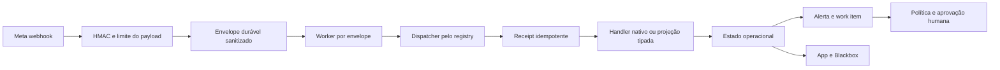

# Relatório de implementação — 33 webhooks Meta

## Escopo entregue localmente

- Registry canônico com 33 campos, handlers e destinos operacionais.
- Receipts idempotentes, estados operacionais, assinaturas desejadas/observadas,
  políticas de automação e jobs de reconciliação.
- Processamento assíncrono e retry limitado, sem manter o callback aberto.
- Central tenant em `/app/conexoes/whatsapp/webhooks`.
- Central administrativa em `/blackbox/official-whatsapp?tab=webhooks`.
- Matriz detalhada em `docs/META_WEBHOOK_IMPLEMENTATION_MATRIX.md`.

## Fluxo implementado

## Migration

- Revisão de controle: `zf3y6v9w0s42`; revisão corretiva de política RLS: `zg4z7w0x1t53`.
- Revisão anterior: `ze2x5u8v9r31`.
- Tabelas: receipts, operational states, subscription states, automation
  policies e subscription jobs.
- RLS e papéis AWS foram ampliados para as novas tabelas.
- Nenhuma migration anterior foi editada.

## Segurança

- HMAC continua obrigatório antes do processamento.
- Conexão e workspace são resolvidos antes do dispatcher.
- A unicidade do receipt impede repetição do efeito pelo mesmo item.
- O fingerprint usa o item sanitizado completo, não um resumo de UI.
- Segredos, tokens e assinatura não entram nas projeções exibidas.
- Falha em um item não converte os demais em sucesso ou fracasso fictício.
- Handlers nativos somente concluem o receipt depois do efeito de domínio.
- Retry manual de handler nativo é bloqueado; o replay pertence ao envelope
  durável, evitando falso sucesso parcial.
- Automação nasce desabilitada em `observe_only`; eventos sensíveis exigem
  aprovação humana.

## Desempenho e observabilidade

- O callback persiste o envelope e delega o trabalho ao worker.
- Receipts registram tentativas, status, erro sanitizado e timestamps.
- Retry transitório: no máximo três tentativas, apenas para 429 e 5xx.
- Erros de permissão, contrato ou inelegibilidade são terminais.
- App e Blackbox mostram recebidos, processados, falhos e nunca observados.
- O build local e os testes não comprovam os alvos p95 em produção. Latência,
  backlog e idade do receipt precisam ser medidos depois do deploy.

## Teste “Oi”

O caminho nativo `messages` está coberto localmente, incluindo assinatura,
envelope, worker, normalização, receipt e conclusão após o handler. Nenhuma
mensagem real foi enviada nesta implementação. O aceite externo continua
pendente até que a Meta entregue um novo `Oi` ao callback definitivo e ele
apareça na conversa correta via websocket, sem refresh nem contato duplicado.

## Estado externo

Nesta entrega não houve deploy, alteração de assinatura na Meta, envio de
mensagem ou reconciliação contra ativos reais. Portanto, nenhum campo foi
promovido artificialmente a `externally_proved`.

Depois do deploy, cada campo deve terminar em um dos estados permitidos:

- `externally_proved`;
- `locally_proved_waiting_provider_event`;
- `subscribed_waiting_event`;
- `manual_subscription_required`;
- `not_eligible_for_asset`;
- `provider_rejected`;
- `temporarily_unavailable`.

## Evidências locais

- Verificador registry/matriz: 33 campos, handlers e linhas.
- Contrato de release AWS validado.
- TypeScript sem erros.
- Testes frontend dirigidos verdes.
- Build de produção do frontend concluído.
- Suíte backend dirigida mais recente: 43 testes verdes.
- Ciclo PostgreSQL descartável já executado: upgrade, downgrade intermediário,
  upgrade, downgrade até base, upgrade, `alembic check` e papéis restritos.
- `git diff --check` verde.

## Pendências que dependem de autorização ou provedor

1. Criar SHA e imagem candidata.
2. Aplicar a migration uma única vez.
3. Publicar API, worker, App e Blackbox pelo mesmo digest.
4. Executar preview e reconciliação das assinaturas.
5. Registrar a resposta real da Meta por campo.
6. Executar o teste “Oi” sem resposta automática.
7. Capturar screenshots e evidência sanitizada do painel Meta.
8. Medir p95, backlog e websocket no ambiente publicado.

Essas pendências não são chamadas de concluídas por teste local ou mock.
