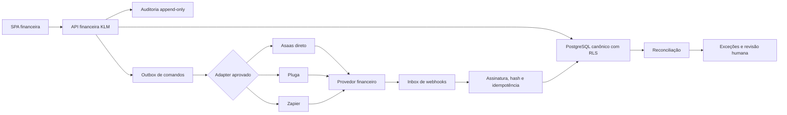

# Plano do upgrade financeiro pausado - 2026-07-22

## 1. Controle da decisão

| Campo | Valor |
|---|---|
| Status | **PAUSADO** |
| Data da decisão | 2026-07-22 |
| Gatilho exato para reabrir | **destravar upgrade de funções financeiras** |
| Ambiente permitido nesta fase | Local/offline |
| Credenciais externas | Não solicitar, não inserir e não persistir |
| Chamadas externas financeiras | Zero |
| Conexão real comprovada | Nenhuma |

O gatilho precisa ser usado literalmente pelo proprietário em uma nova decisão. Ele
autoriza reabrir o trabalho de implementação e homologação; não autoriza sozinho
inserir credenciais, abrir tráfego, emitir cobranças ou movimentar dinheiro.

Este congelamento cobre o upgrade financeiro nativo/avançado e o onboarding externo
do Asaas. Ele não desabilita o financeiro local já existente e não remove os demais
conectores catalogados.

## 2. Limite de afirmação

O estado atual prova apenas que:

- lançamentos, recebíveis, despesas, estornos e lembretes podem continuar no banco local;
- indicadores e projeções locais continuam visíveis na SPA;
- uma rota de lançamento pode ser registrada como plano local pendente;
- o onboarding externo do Asaas falha fechado antes de criar cliente HTTP;
- webhooks de `asaas`, `conta_azul`, `pluga` e `zapier` permanecem bloqueados pelo gate financeiro;
- registros existentes de outros conectores foram preservados.

O estado atual não prova:

- autenticação, homologação ou conexão com Asaas, Pluga ou Zapier;
- criação, liquidação ou baixa de boleto, Pix ou cartão;
- entrega real de webhook;
- reconciliação com extrato bancário;
- disponibilidade, conformidade ou segurança de um provedor externo;
- adequação jurídica, tributária, contábil ou ética de cobranças e splits.

## 3. Escopo atual preservado

### 3.1 Funções locais disponíveis

| Capacidade | Fonte atual | Estado |
|---|---|---|
| Recebíveis, despesas e estornos | `FinanceEntry` | Disponível localmente |
| Status pendente, agendado, pago, atrasado e cancelado | `FinanceEntryStatus` | Disponível localmente |
| Vencimento, valor, moeda, tags e vínculo com caso | `FinanceEntry` | Disponível localmente |
| Lembretes e resolução manual | `FinanceReminder` | Disponível localmente |
| Política de lembrete e notificação | settings do workspace | Disponível localmente |
| Visão de recebido, aberto, atrasado e próximos vencimentos | `FinanceService.get_overview` | Disponível localmente |
| Metadados de integrações | `IntegrationConnection` | Registro local; não prova conexão |
| Contrato da API do workspace | superfície OpenAPI local | Preservado localmente |
| Faturas, estimativas, produtos e aging projetados | contexto CRM local | Leitura local preservada |

### 3.2 Upgrade pausado

- onboarding e validação externa do Asaas;
- envio de cobrança e consulta de saldo no provedor;
- consumo de webhook financeiro externo;
- baixa automática, recorrência, régua de cobrança e conciliação;
- boleto, Pix, cartão, split e estorno executados por provedor;
- motor avançado de honorários e centros de custo;
- exportação contábil automatizada;
- adoção de ERP/OSS financeiro adicional.

### 3.3 Conectores preservados

`Asaas`, `Conta Azul`, `ZapSign`, `DocuSign` e `custom` continuam no enum e no
catálogo. O congelamento não apaga conexões existentes. Na interface financeira,
Asaas e Conta Azul aparecem como **Em breve**; os demais permanecem visíveis e não
recebem uma afirmação nova de conexão.

## 4. Escopo mínimo de lançamento

Antes do gatilho, o caminho operacional é exclusivamente local:

1. manter os lançamentos e lembretes no financeiro local;
2. escolher uma rota futura entre Asaas direto, Pluga ou Zapier;
3. registrar o plano com status `pending` e sem segredos;
4. documentar mapeamento, eventos, idempotência e responsabilidade humana;
5. não testar conta, token, webhook público ou cobrança real.

### 4.1 Rota A - Asaas direto

Indicada quando o KLM precisar controlar integralmente o ciclo da cobrança, a
idempotência, os webhooks, a reconciliação e a auditoria.

Pacote futuro mínimo:

- adapter tipado e versionado;
- cliente separado para sandbox e produção;
- secret store fora do banco de negócio e fora do frontend;
- outbox para comandos de criação, alteração, cancelamento e estorno;
- inbox de webhook com recibo bruto, hash, assinatura e deduplicação;
- reconciliação entre cobrança, pagamento e liquidação;
- sandbox homologado antes de qualquer produção.

### 4.2 Rota B - Pluga

Indicada para um primeiro lançamento de menor código quando os gatilhos e ações
necessários estiverem cobertos pela Pluga.

O KLM continua responsável por:

- produzir e receber payloads versionados;
- gerar uma chave idempotente por intenção financeira;
- validar workspace, caso, valor, moeda e estado anterior;
- guardar recibo, correlação e resultado;
- reconciliar o estado recebido com a fonte canônica;
- impedir que uma automação intermediária vire fonte de verdade.

### 4.3 Rota C - Zapier

Indicada quando o escritório já operar fluxos no Zapier ou precisar de uma integração
temporária não atendida pela Pluga.

O contrato deve usar `Catch Hook` ou `Catch Raw Hook` somente depois do desbloqueio,
com URL tratada como segredo, allowlist de eventos, payload mínimo, assinatura adicional
quando tecnicamente possível e reconciliação no KLM. Um `200` do intermediário não
equivale a pagamento confirmado.

### 4.4 Critério de escolha futura

| Critério | Asaas direto | Pluga | Zapier |
|---|---|---|---|
| Controle de domínio | Maior | Médio | Médio |
| Velocidade inicial | Menor | Maior | Maior |
| Dependência do intermediário | Nenhuma além do Asaas | Pluga e Asaas | Zapier e serviços conectados |
| Webhook e replay sob controle do KLM | Integral | Parcial | Parcial |
| Melhor uso | Núcleo financeiro durável | MVP assistido no mercado brasileiro | Ponte flexível ou ecossistema existente |

A escolha final depende de sandbox, cobertura funcional, custo, limites, segurança,
portabilidade e capacidade de reconciliação verificadas na data do desbloqueio.

## 5. Arquitetura futura

Princípios:

- KLM é a fonte canônica de caso, contrato de honorários, intenção e auditoria;
- o provedor é fonte do estado de processamento e liquidação que ele comprova;
- intermediários transportam eventos, mas não decidem o estado contábil final;
- nenhum efeito externo ocorre dentro da transação HTTP da ação humana;
- comandos sensíveis usam outbox, retries limitados, dead letter e reconciliação;
- toda promoção de ambiente é explícita, reversível e auditada.

## 6. Modelo de domínio futuro

Não criar migrations enquanto o status estiver **PAUSADO**. Quando o gatilho ocorrer,
avaliar as entidades abaixo sem substituir prematuramente `FinanceEntry`:

| Entidade candidata | Responsabilidade |
|---|---|
| `FeeAgreement` | Regra versionada de honorários por caso |
| `Charge` | Intenção canônica de cobrança |
| `ChargeInstallment` | Parcela, vencimento e valor imutável da versão emitida |
| `PaymentAttempt` | Tentativa por meio de pagamento e provedor |
| `Payment` | Confirmação de pagamento com evidência |
| `Settlement` | Valor líquido, tarifa e data de liquidação |
| `Refund` | Solicitação e resultado de estorno |
| `CostCenter` | Centro de custo hierárquico do workspace |
| `Allocation` | Rateio de receita, despesa ou honorário |
| `SplitInstruction` | Regra de split versionada e aprovada |
| `ProviderEventReceipt` | Recibo imutável de webhook |
| `ReconciliationRun` | Execução, escopo, totais e divergências |
| `FinancialOutboxCommand` | Comando externo durável e idempotente |

Todos os agregados devem carregar `workspace_id`. Relações com caso, cliente,
contrato e usuário devem rejeitar referências entre workspaces no banco e na camada
de serviço.

## 7. Controles obrigatórios

### 7.1 Idempotência

- cada comando recebe `idempotency_key` gerada no KLM e vinculada ao workspace;
- a chave deve ser única por operação semântica, não apenas por request HTTP;
- retries com a mesma chave e mesmo hash retornam o resultado anterior;
- a mesma chave com payload divergente gera conflito e auditoria;
- webhooks usam o ID do evento do provedor e um hash canônico do payload;
- o banco impõe unicidade, e o worker usa lock para impedir dupla execução concorrente;
- a criação da outbox e a mudança local pertencem à mesma transação;
- timeouts permanecem `unknown` até consulta/reconciliação, nunca viram sucesso presumido.

### 7.2 Webhooks

1. receber corpo bruto com limite de tamanho;
2. resolver workspace e conexão sem aceitar identificador arbitrário do payload;
3. validar assinatura, token, timestamp e proteção contra replay conforme o provedor;
4. persistir recibo bruto criptografado ou minimizado, hash e metadados permitidos;
5. confirmar rapidamente apenas depois da persistência durável;
6. processar de forma assíncrona, idempotente e fora de ordem quando necessário;
7. registrar transição de estado, ator técnico, correlação e evidência;
8. encaminhar falhas definitivas para dead letter e revisão humana;
9. reconciliar periodicamente porque webhook não é garantia de completude.

### 7.3 RLS e isolamento

- ativar e forçar RLS nas novas tabelas financeiras no PostgreSQL;
- definir o workspace da sessão em transação, com fail-closed quando ausente;
- aplicar políticas separadas para leitura, escrita e workers privilegiados;
- workers devem operar com workspace explícito, lote limitado e trilha de serviço;
- chaves externas devem apontar para entidades do mesmo workspace;
- tokens de API devem ter escopo financeiro mínimo, expiração e revogação;
- testes PostgreSQL devem tentar leitura e escrita cruzadas, inclusive por IDs conhecidos.

### 7.4 Auditoria

Registrar em trilha append-only:

- criação, alteração, cancelamento e estorno de cobrança;
- alteração de honorário, vencimento, desconto, multa, juros e centro de custo;
- aprovação humana, override, motivo e versão anterior/nova;
- comando de provedor, idempotency key, correlation ID e resultado sanitizado;
- webhook recebido, validação, deduplicação e transição aplicada;
- divergência, reconciliação, exportação e rollback;
- acesso administrativo e revelação excepcional de informação sensível.

Segredos, PAN de cartão, CVV, QR Code completo e payloads desnecessários não entram
em logs ou auditoria.

### 7.5 Reconciliação

Executar reconciliação de três vias:

1. intenção e estado canônico no KLM;
2. cobrança, pagamento e tarifa informados pelo provedor;
3. liquidação ou extrato bancário autorizado.

Cada item termina como `matched`, `missing_local`, `missing_provider`,
`amount_mismatch`, `status_mismatch`, `duplicate` ou `manual_review`. Ajustes não
reescrevem histórico; criam uma correção vinculada e auditada.

## 8. Regras funcionais futuras

### 8.1 Cobrança

- separar rascunho, aprovação, emissão, envio, vencimento, pagamento e liquidação;
- exigir aprovação humana para descontos, multas, juros, cancelamentos e estornos fora da política;
- versionar régua de lembrete e respeitar opt-out, canal autorizado e horário comercial;
- registrar promessa de pagamento sem tratá-la como receita;
- suspender automação em disputa, erro cadastral, duplicidade ou divergência;
- nunca marcar como pago apenas por uma mensagem ou resposta HTTP de criação.

### 8.2 Honorários

- suportar valor fixo, parcelas, recorrência, hora, marco, êxito e combinações versionadas;
- separar honorários contratuais, sucumbenciais, despesas e reembolsos;
- vincular a regra ao contrato e ao caso com vigência e aprovador;
- preservar base de cálculo, percentual, teto, piso e arredondamento;
- impedir alteração retroativa silenciosa depois de uma cobrança emitida;
- submeter regras jurídicas, tributárias e éticas à revisão profissional aplicável.

### 8.3 Centros de custo

- hierarquia por workspace, área, equipe, unidade e caso quando necessário;
- código estável, nome versionado, vigência e estado ativo/inativo;
- rateios totalizando exatamente 100% ou o valor líquido permitido;
- bloqueio de centro inativo em novos lançamentos sem apagar histórico;
- relatórios por competência, caixa e liquidação claramente separados.

### 8.4 Boleto, Pix e cartão

| Meio | Requisitos mínimos |
|---|---|
| Boleto | vencimento, linha/URL minimizada, expiração, baixa, tarifa, segunda via e conciliação |
| Pix | QR dinâmico, expiração, end-to-end ID quando fornecido, devolução e webhook idempotente |
| Cartão | checkout/tokenização hospedados pelo provedor, sem PAN/CVV no KLM, parcelas, chargeback e estorno |

O frontend KLM não deve coletar dados brutos de cartão. A solução futura precisa
usar componente ou fluxo hospedado/tokenizado aprovado pelo provedor.

### 8.5 Splits

- regra versionada por cobrança, beneficiário, carteira, valor fixo ou percentual;
- validação sobre o valor líquido e tarifas antes do envio;
- soma determinística, arredondamento explícito e beneficiário residual definido;
- idempotência separada para criação, alteração e cancelamento;
- reconciliação de cada parte e tratamento de bloqueio/divergência;
- aprovação jurídica, contábil e do provedor antes de uso real.

### 8.6 Exportação

- CSV e JSON versionados para dados tabulares e integração;
- relatório PDF apenas como apresentação, nunca como ledger canônico;
- filtro por período, workspace, caso, centro de custo, estado e regime;
- valores monetários com moeda, escala e timezone explícitos;
- manifesto com schema, versão, filtros, gerador, contagem e hash;
- permissão específica, auditoria, expiração e proteção do arquivo;
- reimportação nunca deve duplicar cobrança ou pagamento.

## 9. Candidatos OSS citados pelo usuário

A memória arquitetural local anterior citou os candidatos abaixo. Este plano não
instala nenhum deles e preserva as decisões já registradas.

| Candidato | Uso permitido na reavaliação financeira | Decisão atual |
|---|---|---|
| [Twenty](https://github.com/twentyhq/twenty) | Benchmark de metadados e UX | Não usar como núcleo; não copiar código AGPL sem revisão |
| [EspoCRM](https://github.com/espocrm/espocrm) | Referência de REST e metadata API | Integração opcional apenas com necessidade comprovada |
| [Odoo](https://github.com/odoo/odoo) | Contratos de back-office financeiro se Asaas e KLM não cobrirem a operação | Único candidato de ERP/back-office a reavaliar; não adotar agora |
| [SuiteCRM](https://github.com/SuiteCRM/SuiteCRM) | Nenhum no escopo atual | Não adotar |
| [BottleCRM](https://github.com/MicroPyramid/Django-CRM) | Padrões de RLS, auditoria, API, MCP, deduplicação e testes | Fonte de padrões; KLM continua canônico |
| [Frappe CRM](https://github.com/frappe/crm) | Referência de integração com ERPNext | Não adotar no escopo atual |
| [Vtiger OSS](https://github.com/vtiger-crm/vtigercrm) | Nenhum no escopo atual | Não adotar |

Fontes locais verificadas:

- [`../../docs/klm-hub-arquitetura-omnichannel-flows-crm-oss.md`](../../docs/klm-hub-arquitetura-omnichannel-flows-crm-oss.md)
- [`KLM_HUB_PLANO_INCORPORACAO_OSS_V3.md`](./KLM_HUB_PLANO_INCORPORACAO_OSS_V3.md)
- [`oss-upstreams.lock.json`](./oss-upstreams.lock.json)

Qualquer adoção futura exige nova análise de licença, pin de versão, SBOM,
modelo de dados, custo operacional, segurança, rollback e prova de que não cria uma
segunda fonte financeira.

## 10. Rollback futuro

O plano de liberação precisa manter rollback em quatro níveis:

1. **Kill switch de saída:** parar novos comandos sem impedir leitura e reconciliação.
2. **Pausa por conexão:** desativar uma conta/provedor sem afetar os demais workspaces.
3. **Fallback operacional:** voltar a lançamento e baixa manuais preservando IDs externos.
4. **Rollback de versão:** reverter adapter/worker com schema compatível e migração reversível.

Durante rollback:

- não apagar outbox, inbox, recibos, auditoria ou divergências;
- cancelar retries ainda não iniciados com motivo auditado;
- deixar itens em estado `unknown` para reconciliação, sem presumir falha ou sucesso;
- exportar a fila afetada e definir responsável humano;
- testar restauração de backup e downgrade antes do go-live.

## 11. Estratégia de testes

### 11.1 Testes deste congelamento

- frontend: aviso **Em breve**, três rotas locais e ausência de links/inputs de credencial;
- frontend: criação de plano local sempre com status `pending`;
- frontend: ações do financeiro local continuam habilitadas;
- backend: `POST /api/v1/integrations/connect/asaas` retorna `409` mesmo se o gate externo geral estiver aberto;
- backend: o bloqueio ocorre antes de qualquer `httpx.AsyncClient`;
- backend: resposta informa `PAUSADO`, gatilho exato e zero chamadas externas;
- source check: nenhuma migration ou arquivo proibido pertence ao patch.

### 11.2 Testes obrigatórios após o desbloqueio

| Camada | Cobertura mínima |
|---|---|
| Unidade | dinheiro decimal, parcelas, juros, descontos, splits, transições e idempotência |
| Contrato | schemas versionados de Asaas, Pluga/Zapier e webhooks |
| API | RBAC, validação, conflito, retry, timeout e redaction |
| PostgreSQL | RLS forçada, referência cruzada, unicidade e concorrência |
| Worker | outbox, lease, retry, dead letter, crash e retomada |
| Webhook | assinatura, replay, duplicata, ordem invertida e payload divergente |
| Reconciliação | faltas, valores, tarifas, duplicatas, estornos e liquidação parcial |
| E2E sandbox | boleto, Pix, cartão tokenizado, cancelamento, estorno e split aprovado |
| Segurança | SSRF, segredo em log, enumeração de tenant, rate limit e payload malicioso |
| Rollback | kill switch, downgrade, fila pendente, backup e recuperação manual |

### 11.3 Verificação executada em 2026-07-22

| Verificação | Resultado |
|---|---|
| Vitest focado em `finance-upgrade-pause.test.tsx` | 3 testes aprovados |
| TypeScript `tsc --noEmit` com Node 20.19.4 | Aprovado |
| ESLint nos arquivos frontend do recorte | Aprovado |
| Build Vite de produção com Node 20.19.4 | Aprovado |
| Verificador do bundle de produção | Aprovado |
| Pytest do congelamento e segredos de integração | 13 testes aprovados |
| Ruff no novo teste backend | Aprovado |
| Ruff no endpoint, ignorando somente `E501` legado | Aprovado |

O check completo de Ruff no endpoint ainda aponta cinco linhas longas `E501` que já
existiam nos trechos concorrentes do arquivo. Elas não foram reformatadas porque não
pertencem ao congelamento financeiro. O build também informou que a base local do
Browserslist está desatualizada; isso não impediu a compilação.

Nenhum teste sandbox ou de produção é executado enquanto este plano estiver
**PAUSADO**.

## 12. Protocolo de desbloqueio

1. O proprietário usa a frase exata **destravar upgrade de funções financeiras**.
2. Uma nova tarefa registra provedor, rota escolhida, ambiente, responsáveis e limites.
3. O time atualiza este plano e produz ADR, threat model e inventário de dados/segredos.
4. A implementação começa sem credenciais, com fixtures e servidor falso local.
5. Revisão independente valida idempotência, RLS, auditoria, privacidade e rollback.
6. Somente então credenciais de sandbox são recebidas por secret store aprovado.
7. Sandbox precisa passar nos testes funcionais, de segurança e reconciliação.
8. Produção exige aprovação separada, canário, limites e kill switch testado.

## 13. Links oficiais para a fase futura

Links verificados em 2026-07-22; devem ser revistos no desbloqueio porque contratos e
documentação de fornecedores mudam.

### Asaas

- [Autenticação e URLs dos ambientes](https://docs.asaas.com/docs/authentication)
- [Introdução a webhooks](https://docs.asaas.com/docs/about-webhooks)
- [Split de pagamentos](https://docs.asaas.com/docs/split-de-pagamentos)

### Pluga

- [Integrações com Asaas](https://pluga.co/ferramentas/asaas/integracao/)
- [Pluga Webhooks](https://pluga.co/webhooks/)

### Zapier

- [Começar com Webhooks by Zapier](https://help.zapier.com/hc/en-us/articles/8496083355661-How-to-get-started-with-Webhooks-by-Zapier)
- [Enviar webhooks em Zaps](https://help.zapier.com/hc/en-us/articles/8496326446989-Send-webhooks-in-Zap-workflows)

## 14. Evidência de implementação do congelamento

Arquivos de código previstos por esta decisão:

- `app/api/v1/endpoints/integrations.py`;
- `frontend/src/components/finance/FinanceUpgradePauseNotice.tsx`;
- `frontend/src/components/admin/FinanceControlPanel.tsx`;
- `frontend/src/components/admin/FinanceIntegrationsPanel.tsx`;
- `frontend/src/klm/pages/OperationalModulePage.tsx`;
- `frontend/src/klm/components/NativeCRMOperationsPanel.tsx`;
- testes focados de backend e frontend.

A existência desses arquivos não muda o limite de afirmação: não houve uso de
credencial, chamada ao Asaas, Pluga ou Zapier, nem conexão financeira real.
